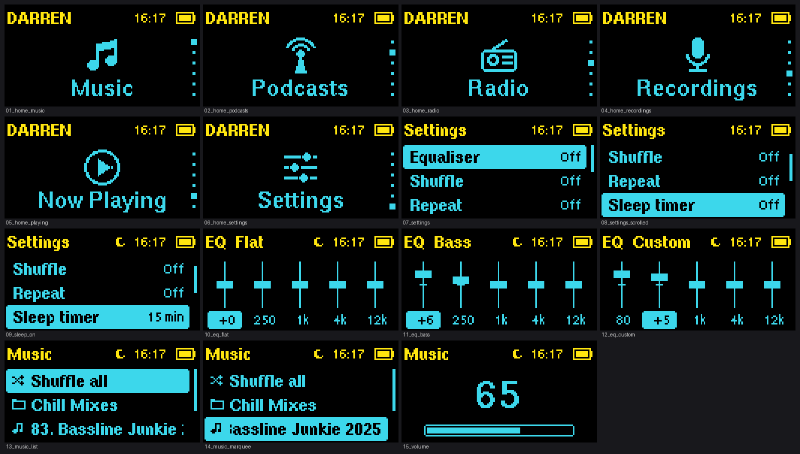
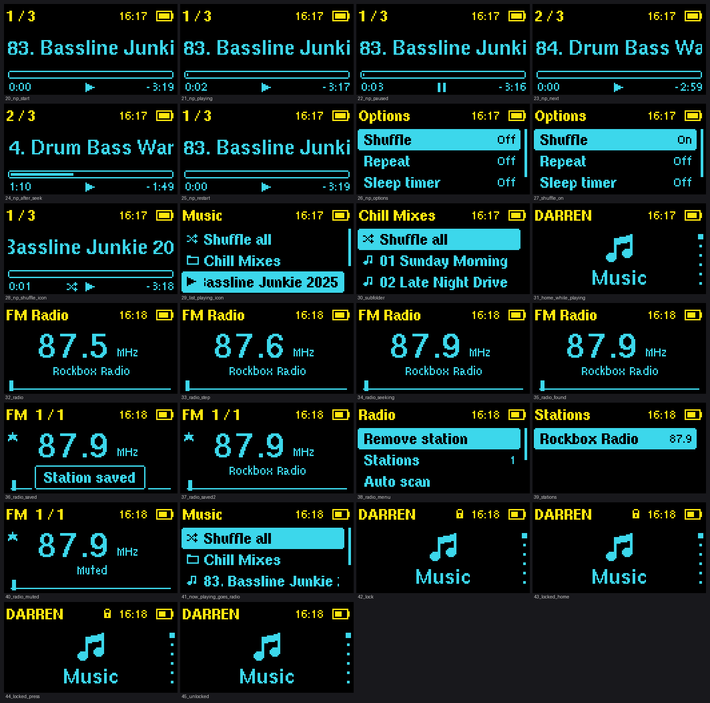

# ClipPlus firmware

An independent firmware project for the SanDisk Sansa Clip+. The first slice is a small, testable UI core and desktop simulator for the 128×64 monochrome display. It is intentionally not a Rockbox-branded build.

## Focus shell v2 (November 2026)

The Rockbox-based fork under [`rockbox/`](rockbox/) now carries a redesigned shell
that runs on a real Clip+: icon Home, folder browser, Now Playing with resume and
accelerating seek, a full FM radio screen (seek, auto scan, saved stations, RDS
name), five-band EQ with presets, recorder, alarm and clock editors, sleep timer
and screen lock. Build, controls, install/rollback and the hardware checklist are
in [HANDOFF.md](HANDOFF.md) (paths there use the local `work/rockbox-focus-fork`
checkout, which is this repository's `rockbox/` folder).




The sections below describe the earlier host-simulator slice and are kept for
history.

## Current status

- UI core: buildable on the host with `make`
- Home screen: six icon-labelled destinations — Music, Radio, Recordings, Settings, Podcasts, Now Playing
- Input model: short presses, repeat navigation, and long-press shortcuts
- Rendering: 128×64 1-bit framebuffer plus PGM screenshot output
- Hardware port: Rockbox-reference route established; custom focus fork in progress; no physical player has been flashed or modified
- Audio, storage, tuner, recorder, power management, bootloader, and update packaging: planned, not yet implemented
- FLAC: supported planned format; decoder integration and target verification are not implemented
- Storage: built-in 8 GB is the primary target; microSD remains optional future expansion
- Hardware port: recovery-first target boundary and host-tested boot preflight; not bootable or flashable

## Build and run

```sh
make
./build/clipplus-sim
```

The simulator accepts `up`, `down`, `left`, `right`, `select`, `home`, `power`, `play`, `hold-select`, `hold-home`, and `quit`. Each run renders `build/clipplus-home.pgm` (centered carousel), `build/clipplus-list.pgm` (minimal text-only vertical menu), `build/clipplus-single.pgm` (one large centered item), and `build/clipplus-stock-inspired.pgm` (larger stock-inspired composition for review), then prints a compact state line. `hold-select` opens Now Playing and `hold-home` returns home.

FLAC integration scope and verification gates are documented in [docs/audio-formats.md](docs/audio-formats.md). The simulator does not decode FLAC.

The storage/media policy for resumable podcasts and long mixes is documented in [docs/storage-media.md](docs/storage-media.md).

The target-port boundary and recovery plan are documented in [docs/port-architecture.md](docs/port-architecture.md). Custom Themes are deferred; the final UI target remains the single large text item menu.

The speed/stability runtime design, alpha gates, and rollback checklist are documented in [docs/runtime-stability.md](docs/runtime-stability.md).

The staged, non-destructive physical test script and result template are in [docs/alpha-hardware-test.md](docs/alpha-hardware-test.md).

The user-confirmed production comparison point is recorded in [docs/known-good-baseline.md](docs/known-good-baseline.md).

The optional, off-by-default alarm service and its unverified sleep/off dependencies are documented in [docs/alarm-clock.md](docs/alarm-clock.md).

The real target prerequisite audit is in [docs/target-build-audit.md](docs/target-build-audit.md); the current environment cannot produce a verified Clip+ alpha image.

The accelerated Rockbox-based fork is included under [`rockbox/`](rockbox/),
with reference build results and the custom first-boot integration boundary
documented in [docs/rockbox-fork-plan.md](docs/rockbox-fork-plan.md). The stock
Rockbox image is not an installation candidate.

The pinned local ARM toolchain and non-linked object-build procedure are recorded in [docs/toolchain.md](docs/toolchain.md).

## Reference inputs

The production image is kept outside this repository. Its SHA-256 is recorded in [docs/hardware.md](docs/hardware.md) for provenance. The downloaded Rockbox tree is used only as a hardware/API reference; new code here does not copy Rockbox source files.

## Source and licensing

The accelerated target fork under `rockbox/` is a modified Rockbox distribution
and is covered by GPL-2.0-or-later together with the notices retained there.
See [NOTICE.md](NOTICE.md), [docs/opensource.md](docs/opensource.md), and
[docs/fork-audit.md](docs/fork-audit.md) before redistributing source or a
compiled image. The complete corresponding source is included under
`rockbox/`; generated build outputs remain excluded.

## Safety

This project currently produces a desktop simulator only. Do not copy its output to a player. The eventual update path must preserve the original image, validate checksums, use a recovery-visible boot stage, and require an explicit user confirmation before writing storage.
